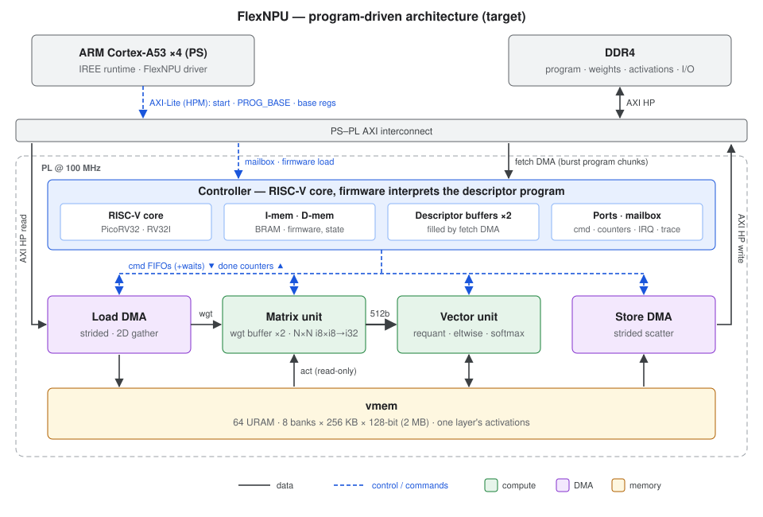

# FlexNPU Tensor Core Update — Spec (draft v0.3)

> Design history: the FlexNPU v2 (fnp2) architecture spec that mini-tpu started from, kept for its rationale and decision log. Names, status and file references are as of 2026-11-01; documents it cites outside this repository are not included. The current contract is [INTERFACE_SPEC.md](INTERFACE_SPEC.md).

Status: **design draft, no RTL/compiler/firmware code written.** Captures the direction agreed in design discussion (2026-10-30). Numbers marked *(est.)* are back-of-envelope estimates, not measurements.

Changes from v0.1: **hybrid datapath** (matrix output only to vector unit; weights via FIFO bypassing vmem; activations vmem → matrix read-only), and the controller **starts as a simple RISC-V core** instead of a hardwired descriptor processor.

Changes from v0.2: resolved open questions — see **§12 Decision log** (core, tokens, vmem + weight buffer, completion signaling, softmax format and placement — design in §4.2.1). The weight FIFO became a **double-buffered weight buffer** with a weight-stationary loop order.

---

## 1. Goal

Move FlexNPU from **"ARM dispatches every op/bundle"** to **"ARM runs a program"**:

> The IREE runtime issues one call — *"run program #3"* (a layer, a block of layers, or the whole model). An on-FPGA controller executes everything else: data movement, GEMM, vector ops, chaining, and synchronization. The ARM is involved only at start, completion, and (in debug mode) checkpoints.

New hardware blocks:

1. **Vector unit + vmem**, with the matrix (GEMM) unit feeding the vector unit directly.
2. **Scalar control unit: a simple RISC-V core** running firmware that interprets the descriptor program.

---

## 2. Motivation (current state)

Today's path: `iree-compile` (workstation) → vmfb → IREE VM on the KV260 ARM → `flexnpu.*` VM import → C driver ([runtime/flexnpu_module.cc](../../runtime/flexnpu_module.cc)) → DMA via `udmabuf` + AXI-Lite registers via `/dev/mem` → FPGA.

The system is **dispatch-bound**, not compute-bound:

| Source | Finding |
|---|---|
| CASE_STUDY_1_DISPATCH_BOUND.md (per-tile era) | host A/B pack 30.4%, tile pack + sync + arm DMA 57.7%, **FPGA compute 6.6%** of NPU time |
| Config B, MobileBERT, 12.55 s wall (SILICON_GROUND_TRUTH.md:462) | softmax engine 4.87 s, GEMM engine 1.92 s, pack 1.13 s, sync 0.78 s, copyback 0.09 s, dispatch/setup/idle ≈ 3.75 s |
| Bundling (`FLEXNPU_BATCH_BUNDLE_N=8`) | 27.97 s → 12.55 s (2.23×) from dispatch reduction alone |
| Peak vs. achieved | 16×16 MACs @ 100 MHz ≈ 25.6 GMAC/s peak; GEMM engine time 1.92 s suggests the array is mostly starved *(est.)* |

What remains on the host per op: VM import call, packing into tile layout, cache sync, DMA arming, polling, readback, i32 → i8 requant on CPU. This spec targets all of these.

---

## 3. Architecture overview



Principles:

- **Control and data paths are separate.** The RISC-V core only issues small commands; it never moves tensor data.
- **Every unit has the same interface:** command FIFO in (commands carry wait conditions), done counter out, memory-mapped on the core's local bus.
- **Units own their inner loops.** One command = one op (or a large tile block); address generation and tile loops run in each unit's hardware sequencer. The core decodes and issues; it does not drive per-tile work.
- **Decoupled execution.** Units run concurrently, synchronized by unit-checked done counters (§4.6), so DMA for tile *i+1* overlaps compute of tile *i*.

### 3.1 Datapath (hybrid)

Mix of TPU v1 (direct weight path) and TPU v2+ (matrix results only through the vector unit):

| Path | Choice | Rationale |
|---|---|---|
| Matrix output | **Only to the vector unit** (no matrix → vmem path) | Requant always applied; raw i32 never lands in vmem; fewer vmem write ports |
| Activations → matrix | **vmem → matrix, read-only** | Activation reuse stays on-chip |
| Weights → matrix | **Load DMA → double-buffered weight buffer → matrix**, bypassing vmem | Weights (~25 MB MobileBERT) don't fit on-chip and are read from DDR once per pass; avoids two extra hops. Weight-stationary loop: one weight tile is reused across all M tiles |
| Activation as weight (attention) | **vmem → weight buffer**, optionally transposed (`LOAD_WGT_VM`, D8) | `Q·Kᵀ` and `P·V` take their second operand from vmem; keeps attention on-chip |

vmem clients: Load DMA (write), matrix (read), vector unit (read/write), Store DMA (read).

---

## 4. Components

### 4.1 Matrix unit (existing GEMM tile, adapted)

- Keep the frozen i8 × i8 → i32 GEMM tile contract (PLUGIN_CORE_CONTRACT.md) as the compute core; N = 8 or 16.
- **Inputs:** activations from vmem (read-only port); weights from a **double-buffered weight buffer** (2 × 16 × 512 B = 16 KB BRAM) filled by the Load DMA, or from vmem by the matrix unit itself (`LOAD_WGT_VM`, with the activation transposer for `Kᵀ`) for attention's activation × activation GEMMs ([INTERFACE_SPEC.md §5.4.1](INTERFACE_SPEC.md)).
- **Loop order: weight-stationary.** Load weight tile W[K, N0] once → stream every activation M-tile from vmem through it → next weight tile (filled into the other half meanwhile). E.g. a 384-row GEMM reuses each weight tile 24× at N=16; weights are read from DDR exactly once.
- **Output:** streamed **only into the vector unit** (e.g. 16 lanes × 32 b = 512 b).
- Own sequencer: tile loop over (M, N, K) for one command; on-chip K-accumulation; chain flags (first / middle / last) for K-split.

### 4.2 Vector unit + vmem

- **Width:** matched to matrix output, e.g. 16 lanes × 32 b.
- **Throughput:** must keep up with the matrix unit (accept matrix output every cycle while requantizing), or it becomes the new bottleneck.
- **Required ops (MobileBERT coverage, priority order):**
  1. Requantize i32 → i8 — TOSA `apply_scale` semantics, **bit-exact** (int32 multiply + rounding shift, per-channel multipliers, clamp). Always applied on matrix output; eliminates i32 readback (4× fewer bytes).
  2. Elementwise add / mul (residuals, MobileBERT NoNorm).
  3. ReLU / clamp.
  4. Softmax — **runs on the FPGA** (see 4.2.1). Keeps attention fully on-chip; no chain break per layer.
  5. Transpose / reshape — prefer strided DMA over vector-unit work.
- Embedding lookup (gather) stays on the ARM, before the program starts.
- **Softmax numerics:** bf16 exp output with a **wide fixed-point row sum**; output tolerance-checked against the f32 reference (not bit-exact).
- **vmem:** all 64 **URAM** blocks (currently unused) as **8 banks × 256 KB, 128-bit words = 2 MB**; each bank = 2 URAM wide × 4 deep, dual-port. Peak ≈ 8 banks × 2 ports × 16 B × 100 MHz = 25.6 GB/s.
  - **Bank assignment by the compiler** so concurrent streams (Load DMA write, matrix read, vector read/write, Store DMA read) hit different banks; a per-bank **round-robin** arbiter (one read port + one write port per bank) is the fallback on conflict — round-robin rather than fixed-priority so no client can starve. Implemented in [hw/rtl/vmem/vmem.sv](../hw/rtl/vmem/vmem.sv).
  - Holds one layer's activations (MobileBERT: 384×512 i8 ≈ 200 KB *(est.)*). Attention scores are **tiled per head** (≈ 147 KB i8 per head; all 4 heads in f32 ≈ 2.3 MB would not fit).

#### 4.2.1 Softmax design

The current slot's cost (LUT 13.4% → 47.9%, ≈ 40 k LUTs; row buffer inferred as ≈ 17.5 k FFs; f32 over DDR; 4.87 s in Config B) comes from its implementation and dispatch, not from the math. Design rules for the vector-unit softmax:

- **Rows stay in vmem** — no dedicated row buffer.
- **Two passes** over the row: pass 1 = online max + sum (running sum rescaled when the max changes); pass 2 = normalize.
- **exp(x − max) = 2^int · 2^frac**: integer part is a shift; 2^frac from a small LUT (≈ 256 entries, BRAM) or piecewise-linear on a DSP.
- **Row sum: wide fixed-point accumulator** in DSP48E2 (48-bit). After max subtraction every term is in (0, 1], so a 384-element row sums to ≤ 384 — exact enough and cheaper than fabric f32 adders.
- **One reciprocal per row** (Newton iterations on DSPs), amortized over the row; then one multiply per element. No per-element divide.
- **Share datapath** with requant / elementwise ops (lane multipliers, adders).

**Implemented** ([hw/rtl/vector_unit/](../hw/rtl/vector_unit/), command format [INTERFACE_SPEC.md §5.7](INTERFACE_SPEC.md)): integer-only in the base-2 domain — inputs scaled to `t = x·log2(e)` in Q16 with a requant-style multiplier / shift, `2^-z` = integer shift × 256-entry ROM (one per lane), online max + sum with rescale per 16-element block, one 47-cycle bit-serial reciprocal per row, and pass 2 reuses the eltwise pipeline's `PASS_A` path (`p = e · R`, then the output requant). Bit-exact against a reference model; within ±1 i8 step of double-precision softmax. Throughput ≈ 2 cycles / element (sequential, not yet pipelined): ≈ 0.3 s for MobileBERT's ~14 M elements at 100 MHz, versus the ≈ 18 ms a fully pipelined 16-lane version would take — a later optimization.

Placing softmax on the FPGA mainly avoids a chain break per layer (≈ 2.3 MB of f32 scores to DDR and back plus an ARM hand-off); raw compute speed vs. 4× A53 is a secondary factor.

### 4.3 Load / store DMA

- Own AXI master(s) on HP ports.
- **Load DMA** has two destinations: vmem (activations, constants) and the matrix **weight buffer**.
- **Strided / 2D (or scatter-gather) transfers**, so tiles are gathered from natural tensor layout directly into the tile layout — replaces host-side packing (the largest single host cost).
- Weight prefetch: fills the idle half of the weight buffer while the matrix unit uses the other half.
- **Implemented** ([hw/rtl/dma/](../hw/rtl/dma/)): AXI4 memory-mapped masters (not AXI-Stream), 128-bit, up to 8 bursts in flight across row boundaries, bursts split at row ends and 4 KB boundaries. LOAD buffers R data in a FIFO before vmem / weight-buffer writes; STORE reads vmem ahead into a FIFO, issues AW ahead of data, and completes on the last B. `CORE_RESET` drains outstanding AXI transactions instead of resetting the masters ([INTERFACE_SPEC.md §11](INTERFACE_SPEC.md)). In simulation each sustains the full beat rate the DDR model offers (12.8 B/cycle with the model's 20 % random stalls). **On the KV260 (HPC0, non-coherent, 2026-11-01): 15.8 B/cycle each for 64 KB, 1.58 GB/s at 100 MHz — 99 % of the 128-bit port.**

### 4.4 Controller — simple RISC-V core

**Core (decided): PicoRV32, RV32I** — single Verilog file, simulates in both iverilog and Verilator (matches the repo's existing sim flow); ~1–2 k LUTs *(est.)*. No M extension: firmware only adds bases, offsets, and strides. Revisit (RV32IM, or VexRiscv for ~2× issue rate) only if measured issue rate limits.

**Memories (BRAM):**

| Block | Size | Contents |
|---|---|---|
| I-mem | 16 KB | Firmware code, loaded by the ARM while the core is in reset |
| D-mem | 8 KB | Firmware stack/data, loop stack, base-register shadows, `issued[]` counts |
| Descriptor buffers | 2 × 16 KB | Program chunks (≤ 256 descriptors each), double-buffered, filled by a fetch DMA |

Total ≈ 14 BRAM36 of 144.

**Program fetch:** a small burst **fetch DMA** (AXI master) copies program chunks from DDR into the descriptor buffers. Firmware starts the fetch of chunk *i+1* before executing chunk *i*. The core itself never executes code from, or loads descriptors directly from, DDR.

**Firmware loop:**

```
wait for doorbell
  → fetch chunk 0 → (prefetch next chunk)
  → for each descriptor: decode → push command (with its wait conditions) to unit FIFO
  → LOOP / NEXT_CHUNK / BREAK / HALT handled in firmware
  → wait for all units idle → write status (+ raise IRQ line)
```

**Issue rate (measured in RTL simulation, [hw/sim/tb/tb_system.sv](../hw/sim/tb/tb_system.sv) P2/P3).** Firmware alone (≈ 100 RV32I instructions per unit command at PicoRV32's CPI ≈ 5) took **≈ 550 cycles per command**, which made short commands dispatch-bound (P2: matrix busy 2.8 k of 13.9 k cycles, no unit ever waited on a dependency). The **hardware issue engine** ([INTERFACE_SPEC.md §8.7](INTERFACE_SPEC.md), D7) now translates runs of unit descriptors: **7 cycles between commands**, P2 **13.9 k → 5.4 k cycles** with units now waiting on real dependencies. Firmware still handles control ops; each `LOOP` iteration costs ≈ 500 cycles of firmware, so a body of only a few tiny ops averages ≈ 140 cycles per descriptor (P3). If that matters: run the innermost `LOOP` in the engine too. On the KV260 the same dispatch test measures 144 cycles per descriptor (simulation 141).

**Why RISC-V from the start:** program semantics (`LOOP`, chunk linking, `BREAK`, base-register resolution, error handling) live in firmware, so the descriptor format can evolve **without re-synthesis**; the hard real-time work stays in unit sequencers.

### 4.5 Interconnect

| Link | Mechanism |
|---|---|
| ARM ↔ controller | AXI-Lite: core reset, firmware load window (I-mem port B), mailbox (`PROG_BASE`, base registers, doorbell), status, debug, perf counters |
| Controller → ARM | Mailbox status, **polled** by the runtime initially; PL→PS IRQ line **wired from day 1** so UIO can be enabled later without re-synthesis |
| Core → units | Per-unit **command FIFO**, memory-mapped on the core's local bus (not the AXI interconnect) |
| Units → core | Per-unit **done counters**, 1-cycle readable (used by firmware only for end-of-program drain and debug) |
| Load DMA → matrix | Double-buffered weight buffer |
| vmem → matrix | Read-only activation port |
| Matrix → vector | Direct wide valid/ready stream |
| Vector ↔ vmem, Load DMA → vmem, vmem → Store DMA | Dedicated banked BRAM/URAM ports |
| DMAs, fetch DMA ↔ DDR | AXI HP master ports |

### 4.6 Dependency tokens (decided: unit-checked counters)

- Each unit keeps a monotonically increasing **done counter** (commands completed).
- Each command carries **wait conditions**: "do not start until unit X's done counter ≥ target". Signaling is implicit — completing a command increments the counter.
- The **unit front-end** holds the command until its conditions hold (a few comparators per unit). Firmware pushes immediately and **never blocks**, so a stalled command on one unit does not hold up issue to the others.
- Descriptors carry **relative distances** (loop-invariant); firmware converts them to absolute 24-bit targets at issue time. Counters reset at program start. Encoding: [INTERFACE_SPEC.md §4.2, §6](INTERFACE_SPEC.md).

### 4.7 Core local memory map

Defined in [INTERFACE_SPEC.md §8](INTERFACE_SPEC.md) (RISC-V side) and §7 (ARM side).

### 4.8 Boot and run sequence

1. **Init (once):** ARM holds core in reset → writes firmware into I-mem → copies program + weights + constants to DDR → sets base registers → releases reset. Firmware reports version + arch identity in the mailbox; runtime checks it.
2. **Per inference:** ARM writes input → writes `PROG_BASE` + doorbell → polls mailbox status (IRQ later) → reads output.
3. **Debug:** `BREAK` descriptors stop the firmware and interrupt the ARM for layer-level dumps.

---

## 5. Program / descriptor format (v2)

**Specified in [INTERFACE_SPEC.md](INTERFACE_SPEC.md)** (program header, 64 B descriptors, opcodes, unit command words, register maps, vector parameter blocks, matrix adapter, error codes). The program is **data interpreted by firmware**; it extends the current 64 B streaming-queue descriptor ([runtime/flexnpu_streaming.h](../../runtime/flexnpu_streaming.h)).

Feature summary:

| Feature | Purpose |
|---|---|
| Opcode per unit (`LOAD`, `LOAD_WGT`, `STORE`, `GEMM`, `VEC_*`) | Multi-unit programs; `LOAD_WGT` targets the weight buffer |
| **Region-register addressing** (R0 WEIGHTS, R1 PARAMS, R2 INPUT, R3 OUTPUT, R4 SCRATCH, R5–R7 user; descriptor holds region + offset) | Position-independent program; no runtime patching; new I/O buffers = one register write |
| 2D strided DMA; **row-major vmem + transposer in matrix adapter**; compiler pre-packs weights | No host or DMA packing at all |
| Requant params (bias, multiplier, shift per channel) in a vmem table | Fused epilogue, bit-exact TOSA `apply_scale` |
| **Wait conditions** as relative distances per unit, checked by the target unit (§4.6) | Unit overlap without firmware blocking; loop-invariant |
| `LOOP count, stride` | Shrink repeating layers (MobileBERT: 24 identical layers → one layer body + loop) — firmware-implemented |
| `NEXT_CHUNK addr` / `HALT` | Chunk linking, end of program — firmware-implemented |
| `BREAK` | Debug checkpoint — firmware-implemented |
| Error reporting | Unknown opcode, bad address, DMA error → mailbox status (no silent hangs) |
| Header: format version, arch identity (`FLEXNPU_HW_TILE`, unit set) | Checked by firmware and runtime at load |

Size: fully unrolled MobileBERT ≈ 10⁴ descriptors ≈ < 1 MB; with `LOOP`, tens of KB *(est.)*.

---

## 6. Software changes

### 6.1 Compiler (largest work item)

A new backend pass in the IREE plugin that, for a region of FPGA-capable ops:

- tiles (weight-stationary loop order), allocates vmem and **assigns vmem banks** (incl. double buffering), schedules across units, computes wait-condition counts,
- emits the descriptor program as a **constant blob in the vmfb** (next to weights),
- replaces the region with one `flexnpu.run_program(id, io buffers)` import call,
- falls back to llvm-cpu where an op is unsupported (chain break).

Start with one MobileBERT layer, bit-exact against `iree-run-module`; generalize afterwards.

**Implementation plan:** COMPILER_RUNTIME_PLAN.md. It covers multiple frontends (TFLite, ONNX, PyTorch), the plugin/backend split, the `run_program` contract, the runtime, verification and phases.

### 6.2 Firmware

- [`hw/fw/`](../hw/fw/) tree: bare-metal C, `riscv-none-elf-gcc -march=rv32i -mabi=ilp32` (no M: firmware only adds bases, offsets and strides), linker script for I-mem/D-mem, startup code, no libc.
- Descriptor decoder, base-register resolution, fetch-DMA double buffering, mailbox/IRQ handling, error reporting, trace.
- Versioned; binary loaded by the runtime at init.

### 6.3 Runtime

- At init: load firmware, check version + arch identity, copy program + weights + constants into DMA-reachable memory (`udmabuf`/CMA), set base registers.
- Allocate program I/O and intermediates in DMA-reachable memory (no copy in/out).
- Per inference: write input, ring doorbell, poll mailbox status, read output. Switch to UIO interrupt later (IRQ already wired).
- VM import calls stay synchronous (CPU has nothing else to do). Async (IREE fences / HAL driver) only if CPU/FPGA concurrency is needed later.

---

## 7. Verification & debug

- **Golden reference per op**, not just end-to-end `byte_sum`: **bit-exact** for all integer ops (GEMM, requant, add/mul, ReLU/clamp); **tolerance-based** for softmax (bf16 exp, fixed-point sum) against the f32 reference.
- **Firmware unit tests** on an ISA simulator (e.g. Spike) with stubbed unit ports; then **firmware + RTL co-simulation** in Verilator/iverilog.
- **`BREAK`-based debug mode:** stop at layer boundaries, dump vmem/DDR, compare against reference.
- **Per-descriptor cycle counters + trace** (firmware-written trace buffer; extend existing streaming `TRACE_*` registers).
- Run the **same descriptor programs on the cycle-level simulator** ([sim/](../../sim/)) before silicon.
- Keep the `FLEXNPU_HW_TILE` agreement rule (compiler / runtime / bitstream / firmware) — enforced via the program header + firmware arch identity.

---

## 8. Resource budget (xck26)

| Resource | Today (N=16 GEMM-only / + softmax slot) | Notes |
|---|---|---|
| LUT | 13.4% / 47.9% | **Tightest.** Vector unit (esp. softmax) must be budgeted carefully; RISC-V core ~1–2 k LUTs (≈ 1–2%) *(est.)* |
| DSP | 20.5% | Headroom for 16-lane requant multipliers |
| BRAM | 21.2% | Controller memories ≈ 14 tiles; weight buffer 16 KB + act staging 16 KB ≈ 8 tiles |
| URAM | unused | **All 64 blocks → vmem** (2 MB) |
| Clock | 100 MHz (`pl_clk0`) | Timing closure of vector unit is a risk |

**Measured (complete v2 RTL incl. `VEC_SOFTMAX`, `LOAD_WGT_VM` and cross-GEMM prefill; out-of-context place + route, `xck26-sfvc784-2LV-c`, Vivado 2024.1, 2026-11-01; [hw/fpga/syn/](../hw/fpga/syn/)):** timing **met at 100 MHz** (WNS +0.64 ns, WHS +0.03 ns).

| Resource | Used | % of xck26 | Largest consumers |
|---|---|---|---|
| LUT | 55.6 k | 47.5 % | vector unit 37.9 k (softmax ≈ 6.2 k of it; 16 lanes × 4 barrel shifters of 64 bits dominate the rest), matrix unit 8.9 k, scalar unit 5.0 k (PicoRV32 2.3 k, issue engine 1.0 k) |
| FF | 43.3 k | 18.5 % | vector pipeline 20.3 k, matrix unit 17.5 k |
| DSP | 524 | 42.0 % | matrix core 256 (incl. adapter), vector unit 258 (16 lanes × 4 pipelined 32 × 32 multipliers + softmax rescale) |
| BRAM | 37.5 tiles | 26.0 % | controller 29.5 (I/D-mem, descriptor banks, trace), matrix staging + weight buffer 8 |
| URAM | 64 | 100 % | vmem, as planned |

CLB slices are 73 % occupied (out of context), so further logic should come with area savings. The vector unit is the lever: its 64-bit barrel shifters (shift amounts are ≤ 63 in practice; a two-level shifter or narrower intermediate) are most of its 37.9 k LUTs.

---

## 9. Phased plan

1. **Spec descriptor format v2** + per-unit command-word formats + core memory map (interface contract for RTL, firmware, sim, compiler). — **Drafted:** [INTERFACE_SPEC.md](INTERFACE_SPEC.md) v0.1, pending review.
2. **RISC-V bring-up on today's hardware:** PicoRV32 + I/D-mem + mailbox + fetch DMA + ARM firmware loader; firmware drives the **existing GEMM path** from a descriptor list. Validates the control plane before new datapath work. — **RTL + firmware done, simulated** against the new matrix / vector units ([hw/rtl/scalar_unit/](../hw/rtl/scalar_unit/), [fw/](../hw/fw/)) and the LOAD / STORE DMAs ([hw/rtl/dma/](../hw/rtl/dma/)): whole programs run DDR → vmem → matrix → vector → DDR in RTL simulation. **Verified on the KV260 (2026-11-01)** with sw/runtime/tests/fnp2_test.c: firmware boot, descriptor fetch from DDR, DMA round trip, GEMM + requant, two-chunk `LOOP` program, attention head with `LOAD_WGT_VM`, error report + `CORE_RESET` recovery — 25,128 values bit-exact; cycle counts within 2 % of simulation; with the complete RTL (softmax + cross-GEMM prefill, 12 / 12 tests, 42,552 values bit-exact) GEMM 256 × 512 × 64 sustains **164 MAC/cycle end to end (64 % of the 256 peak, 16.4 GMAC/s) and 213.5 MAC/cycle (83 %) while the matrix unit is busy**, and a full attention head (Q·Kᵀ → `VEC_SOFTMAX` → P·V) runs on-chip, bit-exact, with softmax within one i8 step of double precision (results in [sw/runtime/README.md](../sw/runtime/README.md)).
3. **Vector unit + vmem + weight buffer** in the hybrid wiring; requant first.
4. **Compiler** emitting descriptors for one MobileBERT layer, bit-exact.
5. Whole-model programs, `LOOP`, then **overlap via wait conditions** (start with fully serial waits, relax as the compiler matures).
6. If issue rate limits: faster core or custom instructions.

---

## 10. Risks

1. Compiler complexity (scheduling, vmem allocation) likely exceeds RTL effort.
2. Op coverage gates "whole model"; unsupported ops break chains.
3. Softmax area estimate (§4.2.1) is unvalidated until synthesized; accuracy of bf16 exp at S=384 needs a tolerance study.
4. Vector unit must sustain matrix-unit output rate.
5. Debuggability of a black-box whole-model run (now firmware + RTL).
6. Firmware toolchain and co-simulation add a new build/test flow.
7. LUT budget and 100 MHz timing closure with a full vector unit.
8. **Controller issue rate:** solved for straight-line unit ops by the issue engine (7 cycles/command); `LOOP` iterations still cost ≈ 5 µs of firmware each (§4.4).

---

## 11. Open questions

Needs a baseline measurement first:

- **Success metric:** target wall time for MobileBERT vs. Config B (12.55 s) and the 4-core llvm-cpu baseline (33.15 s). Both are archived numbers, not reproduced on the current bit/runtime tuple — re-measure first. Include llvm-cpu softmax time on 4× A53 as a reference point for the FPGA softmax (D6).

---

## 12. Decision log

| # | Question | Decision | Rationale | Date |
|---|---|---|---|---|
| D1 | RISC-V core / ISA | **PicoRV32, RV32I** | Single Verilog file fits the iverilog + Verilator flow; firmware is a thin router, so ~25 MIPS is enough; add M or switch core only if issue rate is measured to limit | 2026-10-30 |
| D2 | Dependency tokens | **Unit-checked done counters**; commands carry `(unit, count)` waits | Firmware never blocks → no head-of-line blocking across units; a few comparators per unit; counts computed statically by the compiler | 2026-10-30 |
| D3 | vmem + weight path | **All 64 URAM → 8 banks × 256 KB × 128-bit (2 MB)**, compiler-assigned banks + fallback arbiter; **16 KB double-buffered BRAM weight buffer**, weight-stationary loop | Fits one layer's activations; 25.6 GB/s peak; weight tiles are reused across M tiles, so a plain FIFO is insufficient | 2026-10-30 |
| D4 | Completion signaling | **Poll mailbox status first; PL→PS IRQ wired from day 1** | One hand-off per inference makes polling cost negligible; wiring the IRQ now avoids a re-synthesis when UIO is enabled | 2026-10-30 |
| D5 | Softmax numeric format | **bf16 exp (2^int · 2^frac LUT) + wide fixed-point row sum** (DSP48 accumulator); tolerance-checked. **Implemented as integer-only base-2 fixed point** (Q16 exponent, Q0.16 exp from a 256-entry ROM, 32-bit sum, i8 output), bit-exact with a reference model — 2026-11-01 | f32 slot exceeded LUT budget (105.7%); bf16 slot fit; after max subtraction terms are in (0, 1], so a fixed-point sum is at least as precise as f32 and cheaper. Revised same day from "f32 row sum" | 2026-10-30 |
| D6 | Softmax placement | **FPGA (vector unit)** | Keeps attention on-chip and avoids a chain break per layer; est. ≈ 18 ms compute for MobileBERT; llvm-cpu softmax measurement kept only as a reference | 2026-10-30 |
| D7 | Unit-descriptor translation | **Hardware issue engine** in the controller; firmware keeps control ops and `LOOP` offsets | PicoRV32 firmware measured ≈ 550 cycles per command (dispatch-bound); engine 7 cycles. Keeps PicoRV32 and the descriptor format unchanged | 2026-10-30 |
| D8 | Activation × activation GEMMs | **`LOAD_WGT_VM`**: matrix unit loads a weight half from vmem, straight (`V`) or transposed (`Kᵀ`) | Without it `Q·Kᵀ` cannot run on-chip (byte transpose) and `P·V` bounces through DDR; reuses the adapter's filler and transposer | 2026-10-31 |
