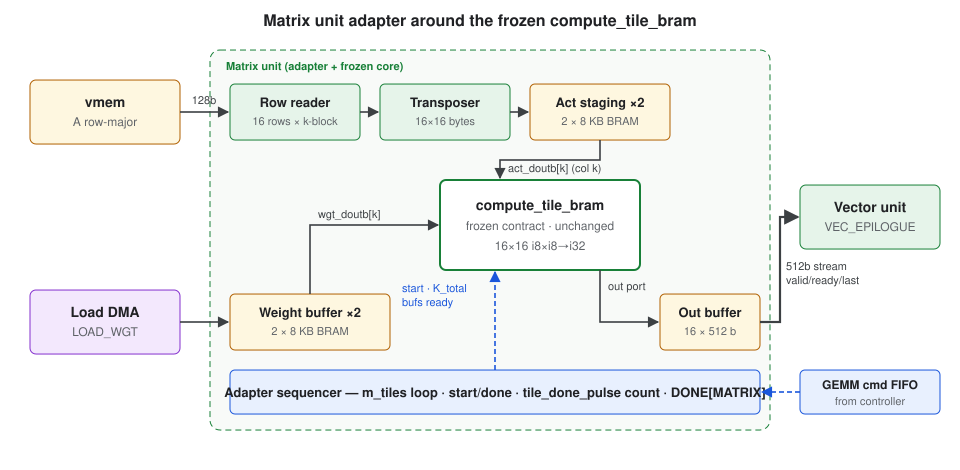

# mini-tpu Interface Spec (draft v0.2)

Status: **draft for review.** Normative interface contract between the compiler, ARM runtime, RISC-V firmware, and RTL for the architecture in [ARCHITECTURE.md](ARCHITECTURE.md). Its constants (register offsets, header and descriptor fields, opcodes, error codes) are defined once in C in [hw/interface/](../hw/interface/), which the firmware and the ARM runtime both include. Covers:

1. Program format and descriptor v2 bit layout (§3–§5)
2. Unit command words, incl. wait-condition encoding (§6)
3. Register maps — ARM side and RISC-V side (§7–§8)
4. Vector unit op set and requant parameter format (§5.4–§5.6, §9)
5. Matrix unit adapter around the frozen GEMM core (§10)
6. Error codes (§11)

Normative for **N = 16** and 16 vector lanes, the defaults.

`array_n = 8` changes nothing here: the ISA keeps 16 x 16 tiles and the matrix unit computes each in 4 passes (§10). Larger arrays (N: 32, 64) and `vector_lanes` (L: 4, 8, 16, 32, 64) change only the points below. vmem words and DMA stay 128 bits. Only N = 16, L = 16 has been simulated.

| Item | Rule |
|---|---|
| `GEMM` | M-tile = N rows, N output columns. `k` stays a multiple of 16 |
| Weight tile (§2.5), `LOAD_WGT` | `k` rows of N bytes, N·`k` bytes contiguous |
| `LOAD_WGT_VM` (§5.4.1) | Straight: row `t` = N/16 words at `src_addr + t · src_pitch`. Transposed: N source rows |
| `VEC_EPILOGUE` (§9.1) | `rows` = N × `m_tiles`; N table entries; `dst` holds N columns per row |
| `cols`, `len` | Multiple of 16 and of L |
| Softmax blocks (§5.7) | L elements, so results depend on L |

---

## 1. Conventions

- Little-endian everywhere. Bit 0 = LSB. Field offsets are byte offsets.
- `uN` / `iN` = unsigned / signed N-bit integer. `f32` = IEEE-754 binary32 bit pattern.
- **DDR addresses** are physical, 40 bits used, carried in 64-bit fields. All DDR addresses and transfer sizes are **16 B aligned** (128-bit HP port beats).
- **vmem addresses** are byte addresses, 21 bits (2 MB), **16 B aligned** (one vmem word = 128 bits). Bank = `addr[20:18]` (8 contiguous 256 KB banks).
- "Reserved" fields must be written as 0 and ignored on read.

---

## 2. Units, regions, data types

### 2.1 Unit IDs

| ID | Unit | Executes |
|---|---|---|
| 0 | LOAD | `LOAD`, `LOAD_WGT` |
| 1 | MATRIX | `GEMM`, `LOAD_WGT_VM` |
| 2 | VECTOR | `VEC_EPILOGUE`, `VEC_ELTWISE`, `VEC_SOFTMAX`, `VEC_LAYERNORM`, `VEC_LUT` |
| 3 | STORE | `STORE` |

Each unit executes its commands **strictly in order**.

### 2.2 Region registers (DDR base addresses)

DDR addresses in descriptors are `(region, offset)`; the effective address is `REGION_BASE[region] + offset (+ loop strides, §5.7)`. Bases are set by the ARM runtime (§7).

| Region | Name | Typical contents |
|---|---|---|
| R0 | WEIGHTS | Pre-packed weight tiles |
| R1 | PARAMS | Requant tables, eltwise/softmax params, masks |
| R2 | INPUT | Program input tensors |
| R3 | OUTPUT | Program output tensors |
| R4 | SCRATCH | DDR spill / intermediates |
| R5 | KV | GPT KV cache, as the compiler lays it out |
| R6 | KV_ROW | KV cache + this token's row; the ARM sets it before each decode step |
| R7 | USER | Free for compiler use |

### 2.3 Data type codes

| Code | Type | Bytes / element | Elements per vmem word |
|---|---|---|---|
| 0 | I8 | 1 | 16 |
| 1 | I32 | 4 | 4 |
| 2 | BF16 | 2 | 8 |

### 2.4 vmem tensor layout (canonical)

- **Row-major**, each row starting 16 B aligned; `pitch` (bytes between row starts) is a multiple of 16.
- Row lengths are padded to a multiple of 16 elements; M is padded to a multiple of 16 rows. **Pad values are unspecified** — correctness relies on weights being zero-padded along K (§5.3), so activation pad values never contribute.
- i32 tensors: 16 elements = 64 B = 4 words per 16-column block.

This layout means **no host or DMA packing**: activations stay row-major; the matrix adapter transposes on the fly (§10).

### 2.5 Weight layout (DDR, pre-packed by compiler)

One **weight tile** = 16 output columns × K: `K` consecutive 16 B rows, row `k` = `{B[k, j0+15], …, B[k, j0]}` (lane `j` at bits `[8j+7:8j]`). Size = 16·K bytes, K ≤ 512, contiguous. Rows `k ≥ K_real` are zero. Columns `j ≥ N_real` are zero.

---

## 3. Program layout

A program is a contiguous blob in DDR at `PROG_BASE`:

```
PROG_BASE + 0x00 : program header (64 B)
PROG_BASE + first_chunk_offset : chunk 0 (≤ 256 descriptors)
...                            : further chunks, linked by NEXT_CHUNK
```

- A **chunk** is ≤ 256 descriptors (16 KB = one descriptor buffer bank).
- The last descriptor of every chunk must be `NEXT_CHUNK` or `HALT`.

### 3.1 Program header (64 B)

| Off | Type | Field | Value / meaning |
|---|---|---|---|
| 0x00 | u32 | magic | `0x4750544D` ("MTPG") |
| 0x04 | u16 | format_version | `2` |
| 0x06 | u16 | header_size | `64` |
| 0x08 | u8 | arch_n | Array size N (16) |
| 0x09 | u8 | units_mask | Required units (bit = unit ID); `0x0F` |
| 0x0A | u16 | vmem_kb | Required vmem size (≤ hardware) |
| 0x0C | u8 | regions_mask | Regions that must be set by the runtime |
| 0x0D | u8[3] | reserved | |
| 0x10 | u32 | first_chunk_offset | Bytes from `PROG_BASE`, 16 B aligned |
| 0x14 | u16 | first_chunk_len | Descriptors in chunk 0 |
| 0x16 | u16 | reserved | |
| 0x18 | u32 | total_bytes | Whole program size |
| 0x1C | u32 | program_id | Compiler-assigned |
| 0x20 | u64 | compiler_hash | Provenance (git hash prefix) |
| 0x28 | u8[24] | reserved | |

Firmware validates magic, version, `arch_n`, `units_mask`, `vmem_kb` against `HW_ARCH` (§7.1) and fails with the matching error code (§11) before executing anything.

---

## 4. Descriptor common layout (64 B)

| Off | Type | Field | Meaning |
|---|---|---|---|
| 0x00 | u8 | opcode | §4.1 |
| 0x01 | u8 | flags | Opcode-specific |
| 0x02 | u8 | wait_mask | Bit `u` set → wait on unit `u` (bits 0–3) |
| 0x03 | u8 | reserved | |
| 0x04 | u16[4] | wait_dist | Per unit `u`: distance `d_u` (§4.2) |
| 0x0C | u32 | reserved | |
| 0x10 | u8 | ddr_region | Memory ops only (`LOAD`, `LOAD_WGT`, `STORE`); else 0 |
| 0x11 | u8[3] | reserved | |
| 0x14 | u32 | ddr_offset | Memory ops only; else 0 |
| 0x18 | u8[40] | payload | Opcode-specific (§5) |

### 4.1 Opcodes

| Opcode | Mnemonic | Executed by |
|---|---|---|
| 0x00 | `NOP` | firmware |
| 0x01 | `LOAD` | LOAD |
| 0x02 | `LOAD_WGT` | LOAD |
| 0x03 | `STORE` | STORE |
| 0x10 | `GEMM` | MATRIX |
| 0x11 | `LOAD_WGT_VM` | MATRIX |
| 0x20 | `VEC_EPILOGUE` | VECTOR |
| 0x21 | `VEC_ELTWISE` | VECTOR |
| 0x22 | `VEC_SOFTMAX` | VECTOR |
| 0x23 | `VEC_LAYERNORM` | VECTOR |
| 0x24 | `VEC_LUT` | VECTOR |
| 0xF0 | `LOOP` | firmware |
| 0xF1 | `NEXT_CHUNK` | firmware |
| 0xF2 | `BREAK` | firmware |
| 0xF3 | `FENCE` | firmware |
| 0xFF | `HALT` | firmware |

Any other opcode → `ERR_BAD_OPCODE`.

### 4.2 Wait conditions (relative distances)

- The controller keeps `issued[u]` = number of commands pushed to unit `u` so far in this program (hardware counter, §8.7).
- For each `u` in `wait_mask`, the issue engine (§8.7) computes the absolute target `t_u = max(0, issued[u] − d_u)` and places it in the command (§6).
- The target unit's front end **holds the command until `DONE[u] ≥ t_u` for every waited `u`**.
- `d_u = 0` means "all commands already issued to `u`". `d_u = k` means "all but the most recent `k`".
- Distances are **loop-invariant**: a `LOOP` body needs no per-iteration patching.

Compiler rules (deadlock freedom):

1. Waits refer only to commands **earlier in program order** (guaranteed by construction).
2. A unit never waits on itself (in-order execution already implies it).
3. **Stream pairing:** the *k*-th `GEMM` is consumed by the *k*-th `VEC_EPILOGUE`. Each `VEC_EPILOGUE` must be the **first VECTOR command after its `GEMM`** in program order.
4. VECTOR commands **never wait on MATRIX** (the stream is the synchronization).
5. All vmem and weight-buffer hazards (RAW, WAR, WAW) are expressed with waits. Hardware does not check. A weight half is written by `LOAD_WGT` (LOAD unit) or `LOAD_WGT_VM` (MATRIX); `LOAD_WGT_VM` and `GEMM` are both MATRIX commands, so their order needs no wait.

`DONE[MATRIX]` counts both `GEMM` and `LOAD_WGT_VM`, so distances to MATRIX count both. Only `GEMM` produces a stream, so rule 3 counts `GEMM`s only.

---

## 5. Opcode payloads

Payload offsets below are **absolute descriptor offsets** (payload starts at 0x18).

### 5.1 `LOAD` — DDR → vmem, 2D strided

| Off | Type | Field |
|---|---|---|
| 0x18 | u32 | vmem_addr |
| 0x1C | u16 | rows |
| 0x1E | u16 | row_bytes (multiple of 16, ≤ 4096) |
| 0x20 | u32 | ddr_stride (bytes between source rows) |
| 0x24 | u32 | vmem_stride (bytes between destination rows; multiple of 16) |

Source = `(ddr_region, ddr_offset)`. Done when all data is written to vmem.

### 5.2 `STORE` — vmem → DDR, 2D strided

Same payload as `LOAD`, direction reversed (`vmem_addr` = source). **Done only after all AXI write responses (B channel) are received** — so the ARM may read results as soon as the program completes.

Field checks (`LOAD`, `STORE`): `rows` ≥ 1; `row_bytes` a non-zero multiple of 16, ≤ 4096; DDR address, both strides and `vmem_addr` 16 B aligned → else `ERR_BAD_FIELD`. Last vmem byte beyond 2 MB → `ERR_VMEM_RANGE`. Any `RRESP` / `BRESP` error → the transfer completes, then `ERR_UNIT_AXI` instead of done.

### 5.3 `LOAD_WGT` — DDR → weight buffer half

| Off | Type | Field |
|---|---|---|
| 0x18 | u8 | half (0 or 1) |
| 0x19 | u8[3] | reserved |
| 0x1C | u16 | k (rows = K, multiple of 16, ≤ 512) |

Copies `16·k` contiguous bytes (one weight tile, §2.5) into the selected half.

### 5.4 `GEMM` — weight-stationary, one weight tile × `m_tiles` M-tiles

| Off | Type | Field |
|---|---|---|
| 0x18 | u32 | act_addr (vmem, row `m0`, column 0) |
| 0x1C | u16 | act_pitch (bytes) |
| 0x1E | u16 | m_tiles (number of 16-row tiles) |
| 0x20 | u16 | k (multiple of 16, ≤ 512) |
| 0x22 | u8 | wgt_half (0 or 1) |
| 0x23 | u8 | reserved |

For each M-tile `t` in `0 … m_tiles−1`: computes `C[16×16] = A[rows 16t … 16t+15, 0 … k−1] · W[0 … k−1, 0 … 15]` (i8 × i8 → i32, wrap-around), and streams 16 output rows to VECTOR (§10.3). Done when the last row is accepted by VECTOR.

**K > 512:** split into chunks of ≤ 512; one `GEMM` per chunk, paired with `VEC_EPILOGUE` modes `STORE_I32` / `ACC_I32` / `ACC_REQUANT_I8` (§5.5).

### 5.4.1 `LOAD_WGT_VM` — vmem → weight buffer half (activation × activation GEMMs)

Fills a weight-buffer half from vmem instead of DDR, so GEMMs whose second operand is an activation (attention: `Q·Kᵀ`, `P·V`) stay on-chip. Executed by MATRIX (it owns the weight buffer and an activation transposer). Field offsets match `GEMM`.

| Off | Type | Field |
|---|---|---|
| 0x18 | u32 | src_addr (vmem) |
| 0x1C | u16 | src_pitch (bytes, multiple of 16) |
| 0x1E | u16 | reserved |
| 0x20 | u16 | k (weight rows; multiple of 16, ≤ 512) |
| 0x22 | u8 | wgt_half (0 or 1) |

Flags (0x01): bit 0 `TRANSPOSE`.

| `TRANSPOSE` | Weight row `t` (16 lanes, §2.5) | Use |
|---|---|---|
| 0 | the vmem word at `src_addr + t · src_pitch` | `B = V`: `src_addr` = `&V[0][j0]`, `src_pitch` = V's pitch |
| 1 | lane `j` = byte `t` of source row `j`, rows `j = 0 … 15` at `src_addr + j · src_pitch` (16 × 16 byte blocks transposed, `k` bytes per source row) | `B = Kᵀ`: `src_addr` = `&K[j0][0]` (16 rows of K), `src_pitch` = K's pitch, `k` = head dim |

- Writes rows `0 … k−1` of the half; rows ≥ k keep old data, which the following `GEMM` with the same `k` never reads.
- **Padding:** §2.5 requires weight rows `t ≥ K_real` to be zero. For vmem-sourced weights the compiler must make the contraction padding zero in the source (e.g. `V` rows ≥ seq_real, `K` columns ≥ head_dim_real), or zero in the activation operand of the next `GEMM`.
- Runs between `GEMM`s (MATRIX is in order). A `LOAD_WGT` into the other half may run concurrently; its writes take priority on the weight-buffer port.
- Done when the last row is written. Errors: `ERR_BAD_FIELD` for k, alignment, `wgt_half` > 1, address beyond vmem.

One attention head (`Q`: M × d, `K`, `V`: S × d, all in vmem), per 16-column output block `j0`:

```
LOAD_WGT_VM  TRANSPOSE  src=&K[j0][0] k=d  half=h      -- K^T block
GEMM         A=Q        k=d           half=h  -> VEC_EPILOGUE -> scores (masking / softmax)
LOAD_WGT_VM  straight   src=&V[0][j0] k=S  half=h'     -- V block (wait VECTOR: probabilities written)
GEMM         A=P        k=S           half=h' -> VEC_EPILOGUE -> context
```

### 5.5 `VEC_EPILOGUE` — consume one GEMM's output stream

| Off | Type | Field |
|---|---|---|
| 0x18 | u8 | mode: 0 `REQUANT_I8`, 1 `STORE_I32`, 2 `ACC_I32`, 3 `ACC_REQUANT_I8` |
| 0x19 | u8 | out_zp (i8) |
| 0x1A | u8 | clamp_min (i8) |
| 0x1B | u8 | clamp_max (i8) |
| 0x1C | u16 | rows (must equal the paired `GEMM`'s `16·m_tiles`) |
| 0x1E | u16 | dst_pitch (bytes) |
| 0x20 | u32 | dst_addr (vmem; i8 output, or i32 partial for `STORE_I32` / `ACC_I32`) |
| 0x24 | u32 | partial_addr (vmem i32 partial, read in `ACC_*` modes) |
| 0x28 | u16 | partial_pitch (bytes) |
| 0x2A | u16 | reserved |
| 0x2C | u32 | params_addr (vmem requant table, §9.1) |

Flags (0x01): bit 0 `PER_TENSOR` (use table entry 0 for all 16 lanes); bit 1 `DOUBLE_ROUND`.

Per row `r`, lane `j` (`c` = stream value):

| Mode | Operation |
|---|---|
| `REQUANT_I8` | `dst_i8[r][j] = requant(c, j)` |
| `STORE_I32` | `dst_i32[r][j] = c` |
| `ACC_I32` | `dst_i32[r][j] = partial[r][j] + c` (wrap) |
| `ACC_REQUANT_I8` | `dst_i8[r][j] = requant(partial[r][j] + c, j)` |

`requant` is defined in §9.1. `dst_addr` may equal `partial_addr` (in-place accumulation).

### 5.6 `VEC_ELTWISE` — elementwise, vmem → vmem

| Off | Type | Field |
|---|---|---|
| 0x18 | u8 | op: 0 `ADD`, 1 `SUB`, 2 `MUL`, 3 `MAX`, 4 `MIN`, 5 `PASS_A` |
| 0x19 | u8 | types: `a_type[3:0]`, `b_type[7:4]` (I8 / I32) |
| 0x1A | u8 | out_type (I8 / I32) |
| 0x1B | u8 | b_bcast: 0 `FULL`, 1 `ROW` (one row broadcast down all rows), 2 `SCALAR` |
| 0x1C | u16 | rows |
| 0x1E | u16 | cols (elements, multiple of 16) |
| 0x20 | u32 | a_addr |
| 0x24 | u32 | b_addr (ignored for `PASS_A`) |
| 0x28 | u32 | out_addr |
| 0x2C | u16 | a_pitch |
| 0x2E | u16 | b_pitch |
| 0x30 | u16 | out_pitch |
| 0x32 | u16 | reserved |
| 0x34 | u32 | params_addr (vmem, §9.2) |

Covers residual adds, MobileBERT NoNorm (`MUL` + `ADD` with `ROW` broadcast of γ / β), ReLU (via clamp), and standalone rescale (`PASS_A`).

### 5.7 `VEC_SOFTMAX` — row softmax, vmem → vmem

Integer-only, base-2 domain (D5). The compiler turns the real scales into multiplier / shift pairs like the requant tables (§9.1); the hardware has no floating point.

| Off | Type | Field |
|---|---|---|
| 0x18 | u8 | in_type (I8 / I32) |
| 0x19 | u8 | out_type (I8 only; anything else → `ERR_BAD_FIELD`) |
| 0x1A | u16 | rows |
| 0x1C | u16 | len (elements per row, multiple of 16, ≤ 1024) |
| 0x1E | u16 | in_pitch (bytes) |
| 0x20 | u32 | in_addr |
| 0x24 | u32 | out_addr |
| 0x28 | u16 | out_pitch (bytes) |
| 0x2A | u8 | in_shift (≤ 63) |
| 0x2B | u8 | out_shift (≤ 63) |
| 0x2C | u32 | mask_addr (vmem, one i32 row of `len`, same units as `t`; used if flag `HAS_MASK`) |
| 0x30 | i32 | in_mult |
| 0x34 | i32 | in_zp |
| 0x38 | i32 | out_mult |
| 0x3C | i8 | out_zp |
| 0x3D | u8 | reserved |
| 0x3E | u16 | q_pos (sequence position of row 0; used if flag `CAUSAL`) |

Flags (0x01): bit 0 `HAS_MASK`, bit 1 `CAUSAL`.

Semantics, bit-exact (`apply_scale(v, m, sh)` = §9.1 with `DOUBLE_ROUND` = 0):

```
t[i]   = sat32(apply_scale(in[i] - in_zp, in_mult, in_shift) (+ mask[i] if HAS_MASK))
           -- t is x·log2(e) in Q16: in_mult · 2^-in_shift ≈ in_scale · log2(e) · 65536,
           -- mask[i] ≈ mask_real[i] · log2(e) · 65536 (e.g. -10000 for blocked positions)
t[i]   = -2^31 if CAUSAL and i > q_pos + r         -- r = row within this command; E of a blocked column is 0
E(z)   = 2^-z for z ≥ 0 (Q16 in, Q0.16 out):  zr = z + 128,  I = zr >> 16,
         E = I > 16 ? 0 : LUT[(zr >> 8) & 255] >> I,   LUT[k] = floor(65536 · 2^(-k/256) + 0.5)
pass 1, per block of 16 (in order):
         M' = max(M, max t[block]);  S = ((S · E(M' - M)) >> 16) + Σ E(M' - t[i]);  M = M'
         (M starts at -2^31, S at 0)
R      = floor(2^46 / S)                       -- S ≥ 65536: the maximum contributes exactly 1.0
pass 2: p[i]   = apply_scale(E(M - t[i]), R, 30)          -- probability, Q0.16
        out[i] = clamp(apply_scale(p[i], out_mult, out_shift) + out_zp, -128, 127)
           -- out_mult · 2^-out_shift ≈ out_inv_scale / 65536 (e.g. 1/256 for out_scale 1/256, out_zp -128)
```

`CAUSAL` needs no vmem traffic. A blocked column outputs `out_zp`. A row sees column 0 at least, so it is never fully blocked. The compiler can also shorten `len` to skip blocks that every row blocks.

Accuracy: against double-precision softmax the result is within ±1 i8 step (simulation: 1–4 of 1,632 outputs differ, each by 1, depending on the random data). Cost per 16-element block ≈ 30 cycles (two passes, sequential) plus 47 cycles per row for the reciprocal.

### 5.7.1 `VEC_LAYERNORM` — row LayerNorm, vmem → vmem

Integer `(x − mean) / sqrt(var + ε)`, without γ / β: the compiler folds those into the next GEMM. Fields sit at the `VEC_SOFTMAX` positions. Design notes: [VEC_LAYERNORM.md](VEC_LAYERNORM.md).

| Off | Type | Field |
|---|---|---|
| 0x18 | u8 | in_type (I8 / I32) |
| 0x19 | u8 | out_type (I8 only; anything else → `ERR_BAD_FIELD`) |
| 0x1A | u16 | rows |
| 0x1C | u16 | len (elements per row, multiple of 16, ≤ 1024) |
| 0x1E | u16 | in_pitch (bytes) |
| 0x20 | u32 | in_addr |
| 0x24 | u32 | out_addr |
| 0x28 | u16 | out_pitch (bytes) |
| 0x2A | u8 | inv_shift (8 … 63) |
| 0x2B | u8 | c_shift (≤ 63) |
| 0x2C | u32 | eps (≥ 1) |
| 0x30 | i32 | inv_mult |
| 0x34 | u32 | reserved |
| 0x38 | i32 | c_mult |
| 0x3C | i8 | out_zp |
| 0x3D | u8[3] | reserved |

`inv_mult · 2^-inv_shift ≈ 1 / len`. `eps = round(len² · ε / in_scale²)`, at least 1. `c_mult · 2^-c_shift ≈ len / (out_scale · 2²⁴)`.

Semantics, bit-exact (`apply_scale(v, m, sh)` = §9.1 with `DOUBLE_ROUND` = 0), per row:

```
x[i]  = clamp(in[i], -(2^20 - 1), 2^20 - 1)
S1    = Σ x[i],  S2 = Σ x[i]²
D     = len · S2 - S1² + eps
mean  = apply_scale(S1, inv_mult, inv_shift - 8)       -- Q8
c     = smallest count with (D << 2c) >= 2^62
q     = floor(sqrt((D << 2c) >> 32))                   -- in [2^15, 2^16)
R     = floor(2^46 / (2 · q))
u[i]  = apply_scale((x[i] << 8) - mean, R, 45 - c)     -- (x - mean) / sqrt(var + ε) / len, Q24
out[i] = clamp(apply_scale(u[i], c_mult, c_shift) + out_zp, -128, 127)
```

### 5.7.2 `VEC_LUT` — table lookup, vmem → vmem

`out[r][c] = table[(u8) in[r][c]]`, i8 in and out. Any i8 → i8 function (GELU, tanh, sigmoid) is one table. Fields sit at the `VEC_ELTWISE` positions.

| Off | Type | Field |
|---|---|---|
| 0x1C | u16 | rows |
| 0x1E | u16 | cols (elements, multiple of 16) |
| 0x20 | u32 | in_addr |
| 0x28 | u32 | out_addr |
| 0x2C | u16 | in_pitch |
| 0x30 | u16 | out_pitch |
| 0x34 | u32 | table_addr (vmem, 256 B; entry `b` at byte `b`) |

The unit reads the table at the start of every command, which costs about 280 cycles.

### 5.8 Control opcodes (firmware)

**`LOOP`** — repeat the next `body_len` descriptors `count` times.

| Off | Type | Field |
|---|---|---|
| 0x18 | u32 | count (≥ 1) |
| 0x1C | u16 | body_len (descriptors; body must lie within the current chunk) |
| 0x1E | u16 | reserved |
| 0x20 | i32[8] | region_stride[R0 … R7] (bytes added per iteration) |

- Effective DDR offset inside the body = `ddr_offset + Σ_levels iter_l · region_stride_l[ddr_region]`.
- Nesting depth ≤ 4 (`ERR_LOOP_DEPTH`).
- vmem addresses are **not** strided. If iterations need ping-pong vmem buffers, the compiler unrolls the body ×2.

**`NEXT_CHUNK`** — continue with the next chunk.

| Off | Type | Field |
|---|---|---|
| 0x18 | u32 | offset (bytes from `PROG_BASE`, 16 B aligned) |
| 0x1C | u16 | len (descriptors, 1 … 256) |

Firmware has normally prefetched it already (it reads the trailing `NEXT_CHUNK` when a chunk lands).

**`BREAK`** — debug checkpoint.

| Off | Type | Field |
|---|---|---|
| 0x18 | u16 | break_id |

Behavior: implicit `FENCE` → `STATUS = BREAK`, `STATUS.code = break_id` → raise IRQ line → wait for doorbell `RESUME` (continue) or `ABORT`.

**`FENCE`** — wait until `DONE[u] == issued[u]` for all units.

**`HALT`** — implicit `FENCE` → `STATUS = DONE` → raise IRQ line → idle.

---

## 6. Unit command words

The issue engine (§8.7) turns each unit descriptor into a **16 × 32-bit command** (512 bits) and pushes it to the unit's command FIFO (depth 8). Firmware can also build and push a command itself through the unit port (§8.1). Units parse the payload at the same byte positions as the descriptor.

| Word | Contents |
|---|---|
| W0 | `[7:0]` opcode, `[15:8]` flags, `[19:16]` wait_mask, `[31:20]` reserved |
| W1 | `[23:0]` t₀ (absolute wait target for unit 0), `[31:24]` t₁`[7:0]` |
| W2 | `[15:0]` t₁`[23:8]`, `[31:16]` t₂`[15:0]` |
| W3 | `[7:0]` t₂`[23:16]`, `[31:8]` t₃ |
| W4–W5 | Resolved 64-bit DDR address (memory ops); 0 otherwise |
| W6–W15 | Descriptor bytes 0x18 … 0x3F (payload, 40 B) |

- `DONE[u]` counters are **24 bits**, reset to 0 at program start. A program may issue at most 2²⁴ − 1 commands per unit (firmware checks → `ERR_COUNTER_OVERFLOW`).
- A unit starts a command only when `DONE[u] ≥ t_u` for all `u` in `wait_mask`, then executes it and increments its own `DONE` on completion.

---

## 7. ARM-side register map (AXI-Lite, 64 KB window)

Base address is assigned at build time (`assign_bd_address`) and recorded in the platform config. Offsets:

### 7.1 Control and status (0x0000–0x00FF)

| Off | Name | Access | Description |
|---|---|---|---|
| 0x000 | HW_ID | RO | `0x5550544D` ("MTPU") |
| 0x004 | HW_VERSION | RO | `[15:0]` minor, `[31:16]` major |
| 0x008 | HW_ARCH | RO | `[7:0]` N, `[15:8]` units_mask, `[31:16]` vmem_kb |
| 0x010 | CORE_CTRL | RW | bit 0 `CORE_RESET` (1 = held in reset; **reset value 1**); bit 1 `IRQ_EN` |
| 0x014 | DOORBELL | WO | 1 `RUN`, 2 `RESUME`, 3 `ABORT`; latched for firmware, self-clears when firmware reads it. `RUN` and `RESUME` set `STATUS = RUNNING` in hardware immediately, so a poll right after the write never sees the previous `DONE` / `BREAK`. `RUN` also resets the §7.4 counters. Write `RUN` only when `STATUS` is not `RUNNING` / `BREAK` |
| 0x018 | STATUS | RO | `[3:0]` state: 0 IDLE, 1 RUNNING, 2 BREAK, 3 DONE, 4 ERROR; `[15:8]` error code (§11); `[31:16]` code (break_id or error detail) |
| 0x01C | IRQ_STATUS | RW1C | bit 0 `DONE`, bit 1 `BREAK`, bit 2 `ERROR` |
| 0x020 | PROG_BASE_LO | RW | |
| 0x024 | PROG_BASE_HI | RW | |
| 0x030 | WATCHDOG | RW | Cycles without any unit progress before `ERR_WATCHDOG`; 0 = off |

### 7.2 Regions (0x0100–0x01FF)

| Off | Name |
|---|---|
| 0x100 + 8·r | REGION_BASE_LO[r] (r = 0 … 7) |
| 0x104 + 8·r | REGION_BASE_HI[r] |

### 7.3 Firmware and error info (0x0200–0x02FF)

| Off | Name | Description |
|---|---|---|
| 0x200 | FW_VERSION | Written by firmware at boot |
| 0x204 | FW_ARCH | Written by firmware: same encoding as `HW_ARCH` |
| 0x208 | FW_HEARTBEAT | Incremented by firmware idle loop (liveness) |
| 0x210 | ERR_DESC | `[15:0]` descriptor index within chunk, `[31:16]` chunk number |
| 0x214 | ERR_UNIT | Unit ID (or 0xFF = firmware) |
| 0x218 | ERR_INFO0 | Error-specific (e.g. offending address low) |
| 0x21C | ERR_INFO1 | Error-specific |

### 7.4 Performance counters (0x0300–0x03FF, RO, reset at `RUN`)

| Off | Name |
|---|---|
| 0x300 / 0x304 | CYCLES_LO / HI (`RUN` → `DONE`) |
| 0x310 + 4·u | UNIT_BUSY[u] — cycles executing |
| 0x320 + 4·u | UNIT_WAIT[u] — cycles head command blocked on wait conditions |
| 0x330 + 4·u | UNIT_STARVED[u] — cycles idle with empty FIFO |
| 0x340 | DESC_COUNT — descriptors processed by firmware (written by firmware at `HALT` / `BREAK` / error; loop iterations count each time) |
| 0x344 | TRACE_COUNT — trace records pushed since `RUN` (ring index = `TRACE_COUNT mod 256`) |

`WAIT` vs `STARVED` separates "dependency-bound" from "issue-bound" — the dispatch-bound analysis of CS1, measured in hardware.

### 7.5 Memory windows

| Off | Window | Access |
|---|---|---|
| 0x2000–0x2FFF | Trace buffer (256 × 16 B records, §8.5) | RO |
| 0x4000–0x5FFF | D-mem (8 KB) | RW (debug) |
| 0x8000–0xBFFF | I-mem (16 KB) | RW **only while `CORE_RESET = 1`** |

### 7.6 Runtime sequence

```
init:     CORE_RESET=1 → write firmware to I-mem window → CORE_RESET=0
          → poll FW_VERSION/FW_ARCH (check vs runtime expectation)
          → copy program/weights/params to DDR (udmabuf/CMA) → set REGION_BASE[*]
infer:    write inputs (R2) → PROG_BASE → DOORBELL=RUN
          → poll STATUS until DONE / BREAK / ERROR (IRQ later)
          → read outputs (R3)
```

---

## 8. RISC-V side memory map (PicoRV32, RV32I)

| Base | Size | Region |
|---|---|---|
| `0x0000_0000` | 16 KB | I-mem (reset vector `0x0000_0000`) |
| `0x0001_0000` | 8 KB | D-mem (stack grows down from `0x0001_2000`) |
| `0x0002_0000` | 16 KB | Descriptor buffer bank 0 (read-only to core) |
| `0x0002_4000` | 16 KB | Descriptor buffer bank 1 |
| `0x1000_0000` | 4 × 256 B | Unit ports (§8.1), unit `u` at `+0x100·u` |
| `0x1000_2000` | 256 B | Fetch DMA (§8.2) |
| `0x1000_3000` | 4 KB | Mailbox (§8.3) |
| `0x1000_4000` | 256 B | Timer / trace (§8.4) |
| `0x1000_5000` | 256 B | Issue engine (§8.7) |

### 8.1 Unit port (per unit)

| Off | Name | Access | Description |
|---|---|---|---|
| 0x00–0x3C | CMD_W0 … CMD_W15 | WO | Staging for the next command. **One staging buffer is shared by all four ports**: write all 16 words, then `PUSH`, before staging the next command |
| 0x40 | PUSH | WO | Any write enqueues W0–W15. Must not be written when `FREE = 0` |
| 0x44 | FREE | RO | Free FIFO slots (0 … 8) |
| 0x48 | DONE | RO | 24-bit done counter |
| 0x4C | UNIT_STATUS | RO | bit 0 busy, bit 1 error, `[15:8]` unit error code |

### 8.2 Fetch DMA

| Off | Name | Description |
|---|---|---|
| 0x00 / 0x04 | SRC_LO / SRC_HI | DDR address |
| 0x08 | LEN | Bytes (multiple of 64, ≤ 16 KB) |
| 0x0C | BANK | 0 or 1 |
| 0x10 | START | Write 1 to start |
| 0x14 | FSTATUS | bit 0 busy, bit 1 done (W1C), bit 2 AXI error |

### 8.3 Mailbox

Same offsets as §7.1–§7.4, seen from the core: `DOORBELL` (read returns and clears the pending command), `HW_ARCH`, `PROG_BASE`, `REGION_BASE[*]`, `WATCHDOG` (RO); `STATUS`, `FW_*`, `ERR_*`, `DESC_COUNT` (RW). Writing `STATUS` with state DONE / BREAK / ERROR sets the matching `IRQ_STATUS` bit and, if `IRQ_EN`, asserts the PL→PS IRQ line.

Core-only registers:

| Off | Name | Access | Description |
|---|---|---|---|
| 0x400 | UNIT_CTRL | WO | bit 0: clear all `DONE` and `issued` counters (program start; FIFOs must be empty) |
| 0x404 | UNIT_SUMMARY | RO | `[3:0]` unit error, `[7:4]` unit busy, `[11:8]` FIFO empty, bit 12 watchdog fired, bit 16 doorbell pending. One read covers the firmware's per-descriptor health check |

### 8.4 Timer / trace

| Off | Name | Description |
|---|---|---|
| 0x00 / 0x04 | CYCLE_LO / HI | Free-running cycle counter |
| 0x10–0x1C | TRACE_W0 … W3 | Staging for one trace record |
| 0x20 | TRACE_PUSH | Append record to the 256-entry ring (§7.5 window) |

### 8.5 Trace record (16 B)

`{u32 cycle_lo, u16 chunk, u16 desc_idx, u8 opcode, u8 event (0 issue, 1 break, 2 error), u16 reserved, u32 info}`.

### 8.6 Core IRQs (PicoRV32 `irq[31:3]` — 0–2 are internal)

| IRQ | Source |
|---|---|
| 3 | Doorbell written |
| 4 | Fetch DMA done / error |
| 5 | Any unit error |

Wired, but masked at reset (PicoRV32 `irq_mask`); the v1 firmware polls. IRQs allow `waitirq` sleep later.

### 8.7 Issue engine

Hardware that turns runs of unit descriptors into unit commands, so firmware only sequences control ops. Firmware writes a start position and a count, then `GO`. For each descriptor the engine reads the 64 B descriptor from the descriptor buffer, maps the opcode to its unit (§2.1), computes the wait targets from `issued[]` (§4.2), resolves the DDR address `REGION_BASE[r] + (ddr_offset + LOOP_ADD[r])` for memory ops, waits for a free FIFO slot, and pushes the command (§6). It stops at the end of the count or **before the first descriptor that is not a unit op** (control op or unknown opcode), leaving that descriptor to firmware.

| Off | Name | Access | Description |
|---|---|---|---|
| 0x00 | ISE_CTRL | WO | bit 0 `GO` (start a run), bit 1 `STOP` (abandon the run) |
| 0x04 | ISE_POS | RW | Write: start `{bank[8], index[7:0]}`. Read: next descriptor (where the run stopped) |
| 0x08 | ISE_COUNT | RW | Descriptors to process, 1 … 256; must stay within the bank |
| 0x0C | ISE_STATUS | RO | bit 0 busy; `[3:1]` stop reason: 0 count reached, 1 non-unit opcode at `ISE_POS`, 2 `ddr_region` > 7, 3 `issued[u]` would overflow, 4 stopped by firmware; `[15:8]` opcode at the stop (reasons 1–3); `[24:16]` commands pushed in this run |
| 0x10 + 4·u | ISSUED[u] | RO | `issued[u]`: every command pushed to unit `u` (engine or §8.1 `PUSH`) since `UNIT_CTRL` clear |
| 0x40 + 4·r | LOOP_ADD[r] | RW | Offset added to `ddr_offset` for region `r` (firmware keeps it equal to the active `LOOP` strides, §5.8) |

- About 7 cycles per descriptor (4 buffer reads, decode, push).
- While busy, the engine owns the descriptor buffer read port. Firmware must not read the descriptor buffer or push through §8.1 until `busy = 0` (after `STOP`, poll `busy`).
- Reset with the core (`CORE_RESET`).

---

## 9. Vector parameter blocks (in vmem)

### 9.1 Requant table (for `VEC_EPILOGUE`)

16 entries (1 if `PER_TENSOR`), one vmem word (16 B) each, entry `j` for output lane `j`:

| Off | Type | Field |
|---|---|---|
| 0x0 | i32 | bias (incl. folded zero-point compensation `−a_zp · Σ_k W[k][j]`) |
| 0x4 | i32 | multiplier |
| 0x8 | u8 | shift (2 … 62) |
| 0x9 | u8[7] | reserved |

`requant(c, j)` — **bit-exact** with TOSA `apply_scale` as implemented in `runtime/flexnpu_module.cc` (`apply_scale_tosa`):

```
v      = c + bias[j]                                   (i32 wrap)
prod   = (i64)v * (i64)multiplier[j]
round  = (i64)1 << (shift[j] - 1)
if DOUBLE_ROUND and shift[j] > 31:
    round += (v >= 0) ? (1 << 30) : -(1 << 30)
r      = (i32)((prod + round) >> shift[j])            (arithmetic shift)
r      = r + out_zp
out    = clamp(r, clamp_min, clamp_max)  → i8
```

### 9.2 Eltwise params (64 B = 4 vmem words)

| Off | Type | Field |
|---|---|---|
| 0x00 | i32 | a_zp |
| 0x04 | i32 | a_multiplier |
| 0x08 | u8 | a_shift |
| 0x10 | i32 | b_zp |
| 0x14 | i32 | b_multiplier |
| 0x18 | u8 | b_shift |
| 0x20 | i32 | out_multiplier |
| 0x24 | u8 | out_shift |
| 0x25 | u8 | mul_shift |
| 0x30 | i8 | out_zp |
| 0x31 | i8 | clamp_min |
| 0x32 | i8 | clamp_max |
| 0x33 | u8 | flags (bit 0 `DOUBLE_ROUND`) |

All other bytes reserved.

Semantics (bit-exact, composition of TOSA `RESCALE` / `ADD` / `SUB` / `MUL` / `MAXIMUM` / `MINIMUM`):

```
a' = apply_scale(a - a_zp, a_multiplier, a_shift)
b' = apply_scale(b - b_zp, b_multiplier, b_shift)      (not for PASS_A)
r  = ADD: a'+b' | SUB: a'-b' | MAX/MIN | PASS_A: a'
     MUL: ((i64)a' * b' + (mul_shift ? 1 << (mul_shift-1) : 0)) >> mul_shift
out_type I32: out = r
out_type I8:  out = clamp(apply_scale(r, out_multiplier, out_shift) + out_zp, clamp_min, clamp_max)
```

Identity rescale: `zp = 0, multiplier = 1 << 30, shift = 30`.

---

## 10. Matrix unit adapter (wraps the frozen GEMM core)

The frozen `compute_tile_bram` ([PLUGIN_CORE_CONTRACT.md](../../docs/PLUGIN_CORE_CONTRACT.md)) is reused **unchanged**. The adapter replaces the old DMA/ping-pong shell around it.



### 10.1 Activation path (vmem → core)

- The core reads `act_doutb[addr = k]` = column `k` of the 16-row A tile (lane `i` = `A[i, k]`).
- vmem holds A row-major (§2.4): one vmem word = 16 consecutive `k` of one row.
- **Transposer:** the adapter reads 16 words (rows 0–15, k-block `kb`) and transposes them as a 16 × 16 byte block into 16 column words, written to a **double-buffered act staging BRAM** (2 × 512 × 16 B = 16 KB) at addresses `16·kb … 16·kb+15`.
- Throughput: 1 vmem read → 1 column per cycle, matching the core's 1 k-step per cycle.
- `act_buf_ready` is asserted when the staging half for the current M-tile is fully written. The half is released after `k / K_TILE` `tile_done_pulse`s.

### 10.2 Weight path

- `wgt_doutb[addr = k]` is served directly from the weight buffer half named by `wgt_half` (layout §2.5 = exactly the core's lane order).
- `wgt_buf_ready` = half loaded (by the most recent `LOAD_WGT` or `LOAD_WGT_VM` to that half, ordered via waits).
- `LOAD_WGT_VM` (§5.4.1) reuses the activation filler (row reads at `src_pitch`) and the transposer (`TRANSPOSE = 1`) or takes vmem words directly (`TRANSPOSE = 0`); rows pass through a 4-entry queue into the weight-buffer write port, where `LOAD_WGT` writes from the LOAD unit have priority.
- The same half is reused for all `m_tiles` core starts (weight-stationary).

### 10.3 Output path (core → VECTOR)

- The core writes 16 rows × 512 b to its OUT port; the adapter captures them in a **double-buffered** output buffer (2 × 16 × 512 b, half = tile mod 2) and streams them to VECTOR, so the core can start tile *t+1* while tile *t* drains.
- **Stream:** `tdata[511:0]` (lane `j` = `C[r][j]`, i32, at `[32j+31:32j]`), `tvalid`, `tready`, `tlast` (last row of the `GEMM` command).
- VECTOR raises `ERR_STREAM_MISMATCH` if `tlast` does not coincide with its `rows` count.

### 10.4 Core parameters

Instantiate the core with the production N = 16 shell values (`fpga/dma/top_axis_bram_16_pingpong.v`): `N = 16`, `K_TILE = 16`, `MAX_K = 1024`, **`ACT_FIFO_DEPTH = 16`**, `OUT_FIFO_DEPTH = 32`, `i_accumulate_in = 0`, `i_writeback_en = 1`.

Implementation: [hw/rtl/matrix_unit/matrix_unit.sv](../hw/rtl/matrix_unit/matrix_unit.sv), verified by [hw/sim/tb/tb_matrix_unit.sv](../hw/sim/tb/tb_matrix_unit.sv) against the `systolic_streaming` core.

### 10.5 Sequencing per `GEMM` command

```
for t in 0 .. m_tiles-1:
    fill the next act staging half from vmem rows act_addr + 16t·act_pitch …   (overlaps previous tile's compute)
    start core: K_total = k
    on core done: stream 16 rows to VECTOR
DONE[MATRIX]++ after last row accepted
```

Staging and output halves alternate per tile across the whole command stream, not per command.

**Cross-GEMM prefill.** Once the filler has filled every tile of the running `GEMM`, MATRIX accepts the next `GEMM` from its command FIFO (if it is offered, i.e. its wait conditions hold) and starts filling that command's tiles into the free staging halves while the running GEMM's last tiles compute and stream. The next GEMM's core work starts after the running GEMM's last row is accepted; its `DONE` still follows in order. This hides the first-tile fill (≈ k + 34 cycles) of every back-to-back `GEMM`. A `GEMM` whose activations are produced by the running GEMM's epilogue waits on VECTOR (§4.2), so it is not offered — and not prefilled — until that data is in vmem. `LOAD_WGT_VM` and malformed commands are taken only when MATRIX is idle.

---

## 11. Error codes

| Code | Name | Raised by | Info |
|---|---|---|---|
| 0x00 | `OK` | — | |
| 0x01 | `ERR_BAD_MAGIC` | FW | |
| 0x02 | `ERR_VERSION` | FW | INFO0 = format_version |
| 0x03 | `ERR_ARCH` | FW | INFO0 = header arch word, INFO1 = HW_ARCH |
| 0x04 | `ERR_REGION_UNSET` | FW | INFO0 = missing regions mask |
| 0x10 | `ERR_BAD_OPCODE` | FW | INFO0 = opcode |
| 0x11 | `ERR_BAD_FIELD` | FW / unit | Alignment / range violation; INFO0 = field offset |
| 0x12 | `ERR_LOOP_DEPTH` | FW | |
| 0x13 | `ERR_LOOP_BODY` | FW | Body crosses chunk end |
| 0x14 | `ERR_CHUNK` | FW | Bad chunk length / missing terminator |
| 0x15 | `ERR_COUNTER_OVERFLOW` | FW | |
| 0x20 | `ERR_FETCH_AXI` | Fetch DMA | INFO0/1 = address |
| 0x21 | `ERR_UNIT_AXI` | LOAD / STORE | INFO0/1 = address |
| 0x22 | `ERR_VMEM_RANGE` | Unit | INFO0 = vmem address |
| 0x23 | `ERR_STREAM_MISMATCH` | VECTOR | INFO0 = rows received |
| 0x30 | `ERR_WATCHDOG` | HW | INFO0 = per-unit FIFO occupancy |
| 0x31 | `ERR_ABORTED` | FW | ARM sent `ABORT` |
| 0x32 | `ERR_CORE_TRAP` | HW | PicoRV32 trapped (illegal instruction, misaligned access, `ebreak`); `ERR_UNIT = 0xFF` |

On any error: firmware stops issuing, records `ERR_*`, sets `STATUS = ERROR`, raises the IRQ line. Recovery = `CORE_RESET` pulse (units and counters reset with the core).

`CORE_RESET` does not reset the LOAD / STORE AXI masters mid-transaction (illegal on AXI). It aborts them: LOAD stops issuing, keeps a pending AR valid until accepted and discards the read data still owed to it; STORE stops reading vmem, completes every burst whose AW was accepted (remaining data, then `WSTRB = 0` beats) and waits for all B responses. Each unit stays busy until drained and only then accepts the next command, so no stale data reaches a later program.

---

## 12. Decisions made in this spec

| # | Decision | Rationale |
|---|---|---|
| I1 | **Row-major vmem + transposer in the matrix adapter**; weights pre-packed by compiler | Removes all host/DMA packing (largest host cost in CS1) |
| I2 | **Relative wait distances** in descriptors, absolute targets in commands | Loop-invariant bodies; hardware compares absolute counts |
| I3 | **24-bit done counters**, 16-word commands | 4 targets fit 3 words; 16.7 M commands/unit/program is ample |
| I4 | **Frozen `compute_tile_bram` reused unchanged** behind an adapter | Keeps the plug-and-play core contract and all existing flavors |
| I5 | **K ≤ 512 per `GEMM`**; longer K via epilogue `STORE_I32` / `ACC_*` modes | Matches existing compiler K-split (512); bounded weight buffer |
| I6 | I-mem **16 KB**, D-mem **8 KB** | Thin-router firmware is ≈ 1–4 KB code *(est.)* |
| I7 | Params (requant tables etc.) live **in vmem**, loaded by `LOAD` | Fixed 64 B descriptors; params reused across M-tiles |
| I8 | 4 units in v1; `LOAD` and `LOAD_WGT` share the LOAD unit | Simplest; split into a separate weight-DMA unit if `UNIT_WAIT` shows contention |
| I10 | **`VEC_SOFTMAX` integer-only** (base-2 fixed point, multiplier / shift parameters, i32 mask in `t` units, i8 output) | Matches the requant parameter style and reuses the vector pipeline's multipliers; BF16 output had no consumer (the matrix unit takes i8); bit-exact reference model instead of a float tolerance spec |
| I9 | **`LOAD_WGT_VM`**: MATRIX fills a weight half from vmem, optionally transposed | Attention's activation × activation GEMMs: `Q·Kᵀ` needs a byte-level transpose no DMA or vector op can do, and `P·V` would otherwise bounce through DDR. Reuses the adapter's filler and transposer |

---

## 13. Deferred / out of scope (v0.1)

- Separate weight-DMA unit (see I8).
- vmem strides in `LOOP`.
- Interrupt-driven runtime (polling first; IRQ wired — D4).
- Descriptor checksums / program signing.
